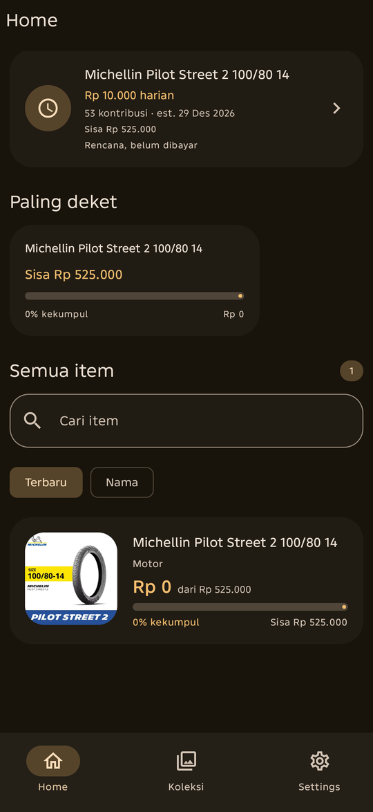
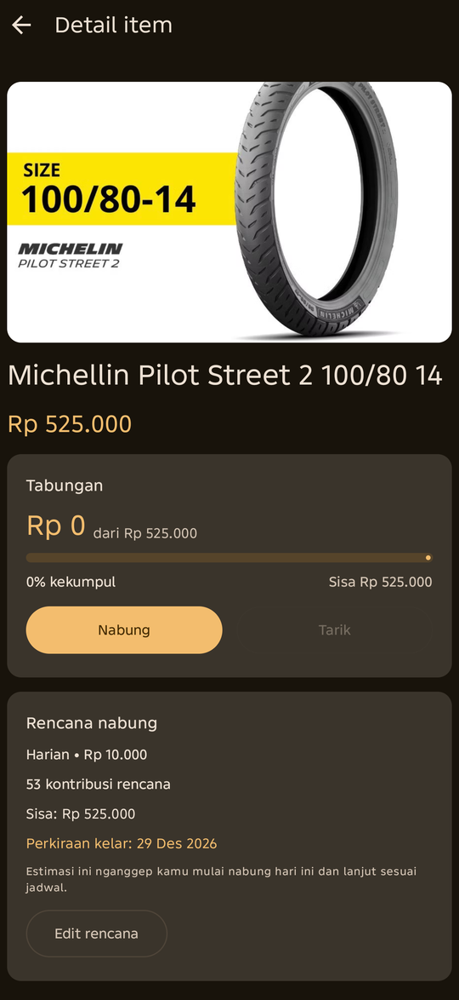
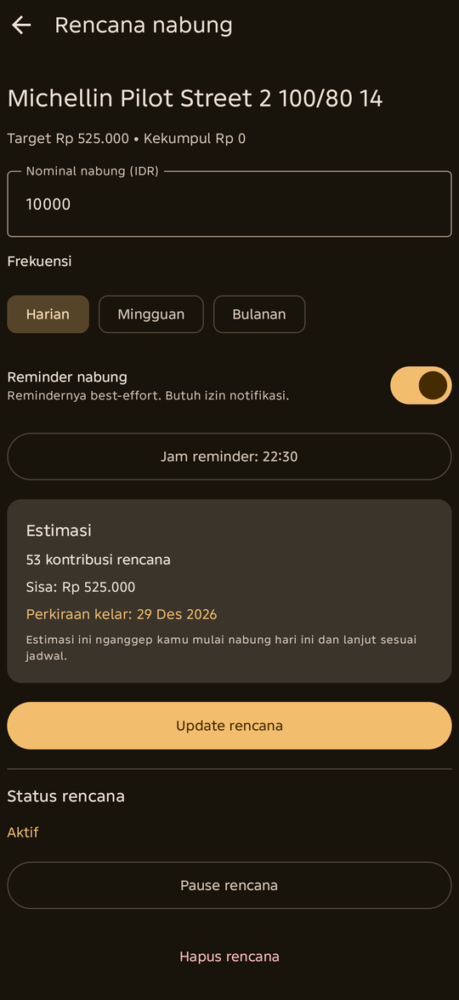
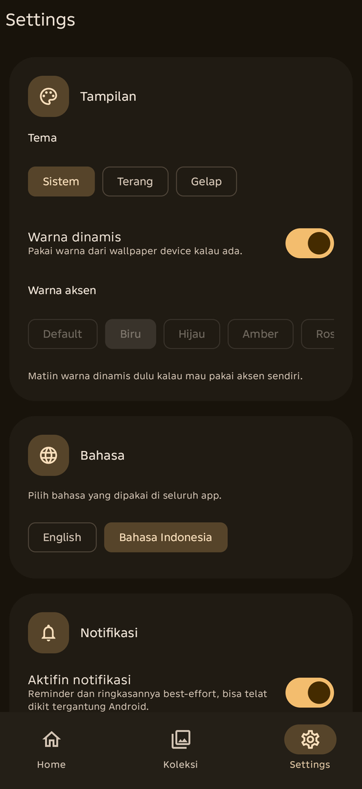

<p align="center">
  
</p>

<h1 align="center">When Yah</h1>

<p align="center"><strong>Wishlist dan tracker tabungan offline.</strong></p>

<p align="center"><strong>When Yah</strong> membantu kamu mencatat barang yang ingin dibeli, menyisihkan uang untuk tiap barang, membuat rencana nabung, dan melihat progresnya. Semuanya tanpa akun, tanpa backend, dan tanpa menghubungkan rekening bank — dan tetap jalan offline. Internet cuma dipakai untuk mengecek update.</p>

<p align="center">
  
  
  
  
  
</p>

> When Yah **tidak** menahan, memindahkan, atau memverifikasi uang sungguhan. Aplikasi ini cuma mencatat rencana dan riwayat tabunganmu.

---

## 🧭 Alur singkat

1. **Tambah barang** — isi nama, harga target, dan opsional gambar, URL, catatan, serta kategori.
2. **Catat setoran** — simpan uang yang benar-benar kamu sisihkan untuk barang itu.
3. **Buat rencana** — pilih nominal dan frekuensi harian/mingguan/bulanan untuk melihat estimasi kapan target tercapai.
4. **Pantau progres** — lihat ringkasan di Home, aktivitas terbaru, dan barang yang paling dekat dengan target.
5. **Tandai dibeli** — barang pindah ke arsip, riwayat tabungan tetap tersimpan.
6. **Ekspor backup** — simpan ZIP berisi data dan gambar ke lokasi pilihanmu.

---

## 📸 Screenshot

<!-- Ganti file di docs/screenshots/ dengan screenshot asli. Rasio 9:20, lebar 540 px. -->

<table align="center">
  <tr>
    <td align="center" width="50%">
      <br />
      <sub><b>Home</b></sub>
    </td>
    <td align="center" width="50%">
      <br />
      <sub><b>Detail item</b></sub>
    </td>
  </tr>
  <tr>
    <td align="center" width="50%">
      <br />
      <sub><b>Rencana nabung</b></sub>
    </td>
    <td align="center" width="50%">
      <br />
      <sub><b>Tampilan &amp; bahasa</b></sub>
    </td>
  </tr>
</table>

---

## ✨ Fitur

### Wishlist dan koleksi
- Tambah barang dengan nama, harga target, gambar lokal, URL pembelian, catatan, dan kategori.
- Kelompokkan barang ke koleksi buatan sendiri. Satu barang maksimal masuk ke satu koleksi.
- Cari dan urutkan barang di Home.
- Halaman detail barang dengan progres tabungan, rencana, dan riwayat transaksi.

### Tabungan per barang
- Catat setoran dan penarikan manual per barang.
- Saldo selalu dihitung dari ledger transaksi, bukan disimpan sebagai angka terpisah.
- Penarikan biasa tidak bisa membuat saldo minus.
- Progres dibatasi 100% untuk tampilan, tapi kelebihan saldo tetap disimpan.

### Rencana nabung
- Kontribusi tetap harian, mingguan, atau bulanan.
- Estimasi jumlah kontribusi dan tanggal tercapainya target.
- Rencana hanya berupa proyeksi — tidak pernah otomatis membuat transaksi atau memotong saldo.
- Recurrence bulanan tetap memakai tanggal awal dan otomatis menyesuaikan akhir bulan.

### Dashboard
- Ringkasan total target, total tersimpan, dan jumlah barang yang sudah tercapai.
- Aktivitas terbaru, rencana terdekat, dan barang yang paling dekat dengan target.
- Daftar semua barang aktif dengan pencarian dan filter.

### Pembelian dan arsip
- Tandai barang sebagai dibeli: seluruh saldo tersedia dicatat sebagai `PURCHASE_SPEND`, lalu barang dipindahkan ke arsip.
- Riwayat transaksi tetap utuh setelah dibeli.
- Barang yang sudah dibeli tidak lagi muncul di total aktif dan tidak lagi punya reminder.

### Backup dan restore
- Ekspor backup ke file ZIP versioned berisi `manifest.json`, `data.json`, dan folder `images/`.
- Manifest menyimpan versi format/schema, ukuran, dan checksum SHA-256.
- Restore memvalidasi manifest, schema, checksum, relasi data, dan ukuran file sebelum mengganti data.
- Proteksi zip-slip dan batas ukuran entri.
- Restore bersifat **full replacement**, bukan merge.

### Notifikasi (opsional)
- Reminder kontribusi per rencana sesuai jam lokal.
- Notifikasi saat target benar-benar tercapai dari transaksi nyata.
- Ringkasan progres mingguan atau bulanan.
- Memakai `AlarmManager`: exact alarm kalau izin “Alarms & reminders” diberikan, fallback inexact yang tetap aman saat Doze kalau tidak.
- Reminder didaftarkan ulang otomatis setelah reboot, update aplikasi, dan saat izin exact alarm diberikan.

### Tampilan dan bahasa
- Material 3 dengan dynamic color.
- Mode terang, gelap, atau mengikuti sistem.
- Pilihan warna aksen.
- Bahasa Indonesia (register Gaul) dan English, bisa diganti kapan saja.
- Onboarding tiga halaman saat pertama kali membuka aplikasi.

### Update
- Cek versi baru dari GitHub Releases otomatis sekali sehari; bisa dimatikan di Settings.
- Dialog update membuka halaman rilis GitHub; APK diunduh dan dipasang manual.
- Pengecekan update gagal dengan tenang saat offline dan tidak mengganggu fitur lain.

### Yang sengaja tidak ada
- Integrasi bank, pembayaran, atau verifikasi transaksi.
- Akun, sinkronisasi lintas perangkat, atau backend.
- Scraping harga atau notifikasi harga otomatis.
- Dukungan multi-currency atau konversi FX.

---

## 💰 Aturan uang yang dijaga

When Yah memakai aturan akuntansi yang ketat supaya angka tabungan tetap konsisten:

| Aturan | Implementasi |
|---|---|
| Mata uang | IDR saja, tanpa kurs atau konversi |
| Tipe angka | Rupiah bulat disimpan sebagai `Long` / SQLite `INTEGER`, bukan `Double`/`Float` |
| Saldo | Selalu diturunkan dari ledger transaksi |
| Ledger | Append-only: `DEPOSIT` (+), `WITHDRAWAL` (−), `PURCHASE_SPEND` (−) |
| Rencana | Proyeksi saja; tidak pernah menulis transaksi |
| Pembelian | Satu `PURCHASE_SPEND` untuk seluruh saldo tersedia; riwayat tetap disimpan |
| Koleksi | Satu barang maksimal satu koleksi; hapus koleksi hanya melepas barangnya |
| Progres | Ditampilkan maksimal 100%, surplus tetap dipertahankan |

---

## 🧱 Tech stack

| Bagian | Teknologi |
|---|---|
| Bahasa | Kotlin 2.2.10 |
| UI | Jetpack Compose + Material 3 |
| Navigasi | Navigation Compose |
| Arsitektur | MVVM + repository + domain calculators |
| Database | Room |
| Dependency injection | Hilt |
| Preferensi | Preferences DataStore |
| Gambar | Coil |
| Backup | kotlinx.serialization + ZIP + SHA-256 |
| Notifikasi | AlarmManager + BroadcastReceiver |
| Build | Gradle 9.4.1, AGP 9.2.1, KSP |
| Minimum | Android 12 (API 31) |
| Target | Android 16 (API 36) |

---

## 📱 Requirement

- Android 12 (API 31) atau lebih baru di perangkat.
- JDK 17 atau lebih baru untuk build.
- Android SDK Platform 37 (`compileSdk = 37`).
- Android Studio versi terbaru yang mendukung AGP 9.2.1, atau build lewat CLI.

`local.properties` berisi path SDK dan bersifat machine-specific (tidak ikut di-commit). Android Studio akan membuatnya otomatis.

---

## 🚀 Build dari source

```bash
git clone https://github.com/HerrscherX86/when-ychhh.git
cd when-ychhh
./gradlew :app:assembleRelease
```

Di Windows, ganti `./gradlew` dengan `gradlew.bat`.

Hasil build ada di:

```
app/build/outputs/apk/release/
```

---

## 📥 Download APK

APK rilis bisa diunduh dari halaman [Releases](https://github.com/HerrscherX86/when-ychhh/releases).

Untuk maintainer: proses signing dan publikasi dijelaskan di [docs/RELEASING.md](docs/RELEASING.md).

---

## 🔐 Privasi

- Tidak ada akun, login, backend, analytics, atau iklan.
- Aplikasi memakai internet **hanya untuk mengecek update** dari GitHub Releases. Tidak ada data pribadi yang dikirim.
- Semua data tersimpan di penyimpanan privat aplikasi.
- Backup hanya keluar kalau kamu memilih lokasinya sendiri lewat file picker Android.
- File backup tidak dienkripsi, jadi simpan di lokasi yang aman.
- Gambar disalin ke penyimpanan privat aplikasi; database hanya menyimpan path relatifnya.

---

## 📌 Status

Versi **1.1** — perbaikan jadwal reminder mingguan/bulanan, pengecekan update dari GitHub, dan migrasi database ke v2. Belum tersedia di Google Play.

---

## 📄 Lisensi

Lisensi open-source untuk repositori ini belum ditetapkan.
